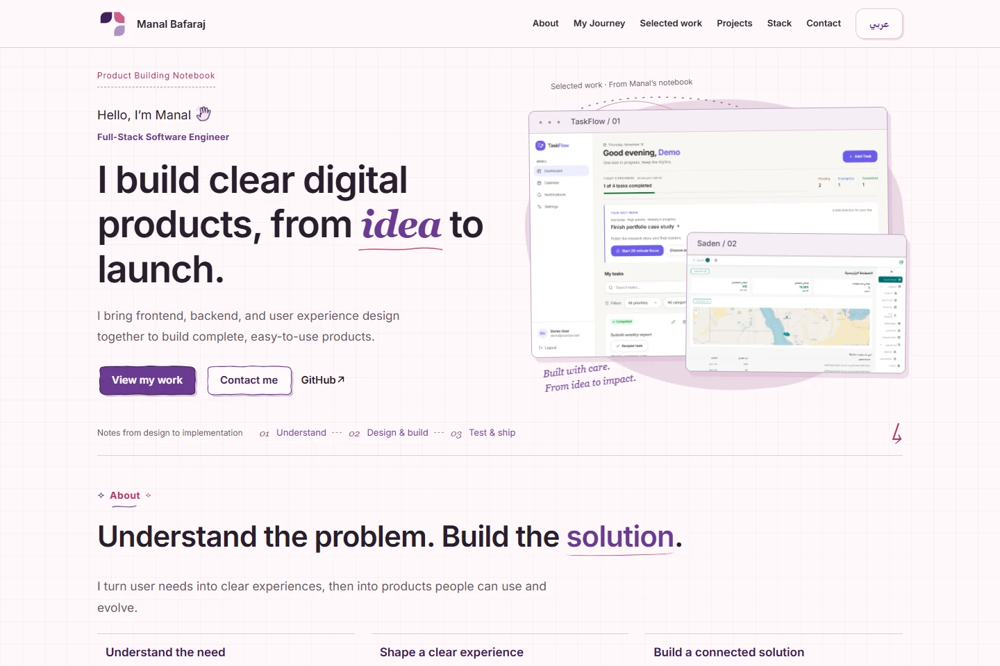

# Manal Bafaraj — Portfolio

A personal portfolio for Software Engineering, Full-Stack, and Frontend opportunities, built with semantic HTML, responsive CSS, and vanilla JavaScript. **Product Building Notebook / دفتر بناء المنتجات** brings together a warm pink grid, paper clippings, engineering sketches, and annotated development entries.

[Live website](https://manalbafaraj.github.io/portfolio/) · [GitHub](https://github.com/ManalBafaraj) · [LinkedIn](https://www.linkedin.com/in/manal-bafaraj-799123264)



## Content

- Introduction, availability, and working principles
- Build Log: dated notebook entries for AppRo8 and Tamheer / Saden, plus shorter learning notes
- Featured projects: TaskFlow and Saden
- Research, dashboards, web platforms, and UI/UX projects
- Technical stack and recruitment contact links

## Languages and accessibility

Arabic (RTL) and English (LTR) are available from the navigation. Language selection is saved locally when browser storage is available. Language, direction, image descriptions, and navigation labels update together. Content remains readable without JavaScript. Includes a skip link, keyboard focus states, responsive navigation, and reduced motion support. The active navigation item follows the section in view.

The Saden gallery includes thumbnails, previous/next controls, direction-aware arrow keys, a native modal viewer, Escape to close, and touch swipes. Use **Zoom to details** to inspect screenshots at their local image resolution; scroll or pan within the viewer, then select **Fit image** to return. Zoom resets when switching images. Without JavaScript, the main gallery image opens as a regular image link.

Hero previews float gently with independent timing and smaller movement on phones. The Idea in Motion mark has a single 850ms introduction. Reduced motion disables the animations and hover movement; page content never depends on an animation to become visible. The compact contact identity card uses translated HTML text and a static SVG mark; the Open Graph image is reserved for link previews.

## Technology and structure

No build step or production dependencies are required. Google Fonts load with system fallbacks. Real project screenshots are stored locally as compressed WebP files with explicit dimensions; images below the hero load lazily.

```text
portfolio_site/
  index.html          Page content and semantic structure
  style.css           Responsive layout and visual identity
  script.js           Translations and navigation behavior
  img/                Project images and portfolio preview
    identity/         Idea in Motion mark, favicons, and Open Graph image
  assets/documents/   Speech emotion classification research
  .nojekyll           Serve the static site without Jekyll processing
  README.md
```

## Run locally

Install Python 3, open a terminal in this repository, and start an HTTP server:

```sh
python -m http.server 8000 --bind 127.0.0.1
```

Visit <http://127.0.0.1:8000>. Keep the terminal running while previewing; press Ctrl+C to stop it. No environment variables or account setup are needed.

## GitHub Pages

GitHub Pages is configured to **Deploy from a branch → main → / (root)** in the existing `ManalBafaraj/portfolio` repository. Push reviewed changes to `main` to publish. Keep `index.html` at the repository root; `.nojekyll` preserves the static files as authored. The existing live URL above remains unchanged. Asset paths are relative and case-sensitive.

Local review files, test scripts, archives, editor state, and private documents are excluded from the published repository.

## Ownership

Portfolio content and project imagery belong to Manal Bafaraj. Do not reuse them without permission.
